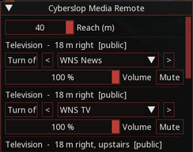

# Media Remote

A remote control for the world radios and TVs near the player in Cyberpunk 2077: power, station or channel, volume and mute, from a Cyber Engine Tweaks window or optional hotkeys. Single-player only.
Version 1.0.3 (window 1.0.2) | For game version 2.5 | Status: in use in my game and working; no written test record; checked with an offline mock test (37 of 37 checks pass)

> This is an unofficial fan work and is not approved/endorsed by CD PROJEKT RED. No game files are included.



## The problem

Changing a radio station, turning a TV down or switching it off normally means walking up to the device and using it by hand. Using a device by hand also distracts nearby NPCs. There is no way to turn down the bar radio you are standing next to.

## What I built

A Cyber Engine Tweaks window and six optional hotkeys that list every radio and TV within reach and control them from where you stand. A redscript system (618 lines) does all the game work; the Lua window (231 lines) only draws. It changes: the power state, station or channel and volume of world radios and TVs you choose, and it stores the volume of devices you turned down in the save.

## How it works

- Every radio and TV registers itself with the redscript system when it streams in (a wrap on its `ResolveGameplayState`). The list is only filtered by distance when the window is open or a remote key is pressed. There is no per-frame work.
- The window lists devices within reach (default 20 m), nearest first, with distance and direction. The device you look at goes on top and can be up to 40 m away. Devices you cannot use by hand (a bar radio, a quest TV) are marked "[public]".
- Power and tuning use the game's own quest actions (`QuestForceON`, `QuestForceOFF`, `QuestSetChannel`), so NPCs are not distracted the way they are by the hand interaction.
- Volume uses the game's own sound parameters on the device. A TV goes from full down to silent (`tv_receiver_volume`). A world radio has no volume parameter of its own, so the mod lowers it with the per-device parameters it does have (up to about -19 dB) and uses the "no station" switch for 0 %.
- Volume levels other than 100 % are saved per device in the save (at most 256 devices) and come back when the device is turned on, changes station or streams in again.
- One lock guards the device list and the saved levels, because the game's device tasks and the CET window touch them from different threads.
- With Night City Finance installed, devices at home do not respond while the power is cut for unpaid rent, as they do by hand. This part is compiled only when that mod is present.

```text
package/
  bin/x64/plugins/cyber_engine_tweaks/mods/CyberslopMediaRemote/init.lua   the window and hotkeys
  r6/scripts/CyberslopMediaRemote/MediaRemote.reds                         device control
tests/mock.lua    runs init.lua against a stubbed game API (37 checks)
```

## Requirements

| Requirement | Version | Link |
|---|---|---|
| Cyberpunk 2077 | 2.5 | |
| Cyber Engine Tweaks | a build for 2.5 | [Nexus Mods, mod 107](https://www.nexusmods.com/cyberpunk2077/mods/107) |
| redscript | a build for 2.5 | [Nexus Mods, mod 1511](https://www.nexusmods.com/cyberpunk2077/mods/1511) |
| Night City Finance (optional) | | see Compatibility |

Requirements are not bundled. Install them first.

## Install

1. Install the requirements above.
2. Copy the contents of `package/` into the game folder, so that `r6\scripts\CyberslopMediaRemote\MediaRemote.reds` and `bin\x64\plugins\cyber_engine_tweaks\mods\CyberslopMediaRemote\init.lua` exist.
3. Start the game, load a save near a radio or TV and open the CET overlay: the "Cyberslop Media Remote" window lists it.

## Uninstall / roll back

1. Close the game.
2. Delete:
   - `bin\x64\plugins\cyber_engine_tweaks\mods\CyberslopMediaRemote\` (also removes its `settings.json`)
   - `r6\scripts\CyberslopMediaRemote\`
3. The saved volume levels stay in the save and are not read without the mod. Saves load fine.

## Configuration

- "Reach (m)" slider in the window: 5 to 40, default 20. Saved in `settings.json` next to `init.lua`.
- Per device in the window: turn on / off, previous / next and a station or channel list, a volume slider (0 to 100) and Mute / Unmute. Unmute returns to the level before the mute.
- Remote hotkeys in CET > Bindings, all unbound by default: "Remote: power on / off", "Remote: next station / channel", "Remote: previous station / channel", "Remote: volume up", "Remote: volume down", "Remote: mute / unmute". Volume keys move in 10 steps. The keys act on the device you look at (up to 40 m), otherwise on the nearest one within reach.

## Status

| Version | Date | Result |
|---|---|---|
| 1.0.0 | 2026-11-22 | No written test record. |
| 1.0.1 | 2026-11-22 | Review fixes. No written test record. |
| 1.0.2 | 2026-11-22 | Window fix found in review. No written test record. |
| 1.0.3 | 2026-11-23 | Radio volume fix. In use in the author's game and working (author's statement, 2026-11-24). No written test record. |

Checked for this repository: `tests/mock.lua` passes 37 of 37 checks on the published `init.lua` with LuaJIT. A source audit compared all five wraps on game methods with the 2.5 game scripts: they match. No redscript compile was run for this repository.

## Compatibility

| Item | Status | Notes |
|---|---|---|
| Night City Finance | optional | Its rent power cut is respected. Not tested together. |
| Custom radio stations | not tested | The station list is read from the game's radio dial at runtime. |

## Known issues

- A radio whose level was changed may not duck under dialogue the way an untouched radio does. Not changed so far.
- No version has a written in-game test record.

## Engineering notes

**Problem.** In the first window, while the station or channel dropdown was open, every frame tuned the current device again: a radio restarted its station and a muted radio blipped, a TV switched channel and queued another volume re-apply, and the whole device list was rebuilt each frame.

**Diagnosis.** Found in a review of 1.0.1, before any in-game run. CET's `ImGui.Selectable(label, selected)` returns the row's selected state on every frame, not "was clicked". The current station is the selected row, so it reported a click on every frame. The same misreading had already made another mod of mine, [Backpack](https://github.com/penicius-code/cp2077-backpack), use items by itself.

**Fix.** 1.0.2 treats a row as clicked only when it is not the current one: `Selectable(label, cur) and not cur`.

**Check.** The mock test now stubs `Selectable` the way CET behaves (returns the selected state, or true on a click). The 1.0.1 window fails 5 of its checks; 1.0.2 passes all 37.

**Another fix, 1.0.3.** A radio set back to 100 % while it was off later played at its old, lower level, because the station-start wrap only applies levels below 100. Now the 100 % values are applied at once.

**Rollback.** Delete the two folders. Each version was installed with a backup of the previous files.

## Changelog

See [CHANGELOG.md](CHANGELOG.md). Latest: 1.0.3 (2026-11-23): a radio set back to 100 % while it is off gets its full values at once.

## Credits and licence

Runs on Cyber Engine Tweaks and redscript, which are not included here. Two ideas are reused from other mods, without their code: the "no station" switch for a silent radio (Radio Silence, World Radios Silenced, Sound of Silence) and the game's TV mute event (TV Mute Control).

MIT, see [LICENSE](LICENSE). The licence covers my code only. Game names and trademarks belong to their owners.

Built with AI assistance (Claude); designed, tested and maintained by me.
